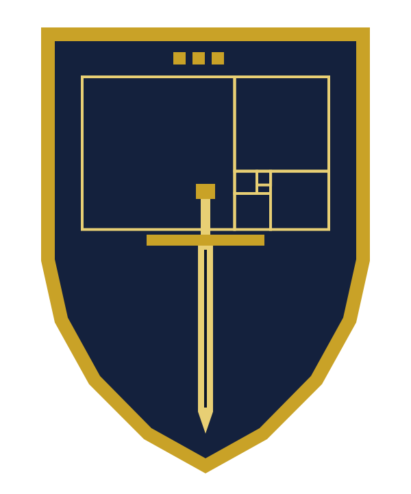

# 無何有騎士王国ヌスクァマ（Regnum Nusquamae）

種類：エンターテインメント　状態：運営中

<!-- first -->

> これは創作であり、遊びです。
> ヌスクァマは、娯楽のために作った架空の国です。学術の研究ではなく、研究の成果を示すものでもありません。
> ヌスクァマは国家ではなく、領土・国民・通貨・旅券を持ちません。
> いかなる実在の国家・王室・騎士団・叙勲・称号とも関係がなく、それらを名乗るものでも、それらに代わるものでもありません。
> ここで贈る騎士の呼び名は、勲章・栄典・騎士の位ではなく、法的な効力もありません。
> 悪意はなく、法令を守って運営しています。
>
> 詳しくは[利用規約](policies/terms.md)と[免責事項](policies/disclaimer.md)にあります。
>
> English: This is a work of fiction, made for entertainment. Nusquama is an imaginary kingdom. It is not a state, and it is not academic research.

ヌスクァマは個人で運営しているため、参加のハードルを極端に高くしています。
参加の道ごとの条件は、[国の仕組み](INSTITUTIONS.md)の「参加のハードル」にあります。

English: Because Nusquama is run by one individual, its barriers to participation are set extremely high. The conditions for each way of taking part are in [Institutions](INSTITUTIONS.en.md), "Barriers to participation".

**国是**：Errata servo, me ipsum rego. ―― 誤りは守り、己を治める。

<!-- entries -->

---

## 建国の宣言

どこにもない国がある。
その名をヌスクァマという。ラテン語で「どこにもない所」。トマス・モアが、のちに『ユートピア』となる島に最初に付けかけた名である。

どこにもない国には、誰でもない王がいる。
その名をネモという。ラテン語で「誰でもない者」。
騎士王ネモ一世は、民を持たない。治めるのは、ただ一人、自分自身である。

この王は、剣を振るわない。
王の武器は検査であり、王の盾は正誤表である。
王の偉さは、誤りの少なさでは量らない。誤りを消さずに残した、記録の正直さで量る。

王位は一代限りで、継ぐ者を置かない。
独りで立つ者だけが、独りで己を正せるからである。

ここに、無何有騎士王国ヌスクァマの建国を宣する。

―― 騎士王ネモ一世　2026年11月7日

---

## 王国基本法

**第一条（創作であること）**　この国は創作である。実在の国家・王室・騎士団・叙勲・称号と関係せず、領土・国民・通貨・旅券を持たない。

**第二条（王）**　王はただ一人、騎士王ネモ一世（Nemo I, Rex Eques Nusquamae）とする。在位は一代限りで、世襲しない。

**第三条（版図）**　王国の版図は、王の本棚と、王が公にした正誤表とする。版図は、王が誤りを一つ認めるたびに広がる。

**第四条（王の誓い）**　王は、一度立てた誓いを黙って取り下げない。誓いを改めるときは、何を何に替えたかを残す。

**第五条（王の過ち）**　王は、自らの誤りを消さず、日付を付けて記録する。消した誤りは、二度目の誤りとみなす。

**第六条（叙任）**　騎士の叙任は無償とする。金銭・物品・役務と引き換えにしない。叙任の条件は一つ、自分の誤りを一つ、公に訂正したことである。

**第七条（騎士団）**　騎士は、正誤表騎士団（Ordo Erratorum）に属する。位は「騎士」の一つだけとし、上下を設けない。

**第八条（称号を使う場所）**　この国の称号は、この国の中でだけ使う。履歴書・論文・名刺・公的な書類・学術の場には書かない。

**第九条（武）**　王国は剣を抜かない。争いは、言葉と証拠で決める。

**第十条（改正）**　この基本法は王が改める。ただし、第一条・第六条・第八条は削らない。

第六条の叙任には、[叙任の規程](policies/knighting.md)の条件も加わります。叙任の規程が条件を足すところは、叙任の規程に従います（叙任の規程「基本法第六条との関係」）。この注は基本法の条ではなく、条の文は改めていません。叙任の願い出の受付は、2026-11-12 から止めており、受付に戻る日は決めていません（叙任の規程「受付の停止」）。

---

## 騎士王の十則

一　推測で空白を埋めるな。分からぬは、分からぬと書け。

二　凍った言葉を書き換えるな。正すなら、別紙に書け。

三　数を語るなら、数え直せる形で語れ。

四　肩書きで己を飾るな。騎士王の名は、この国の中でだけ許す。

五　金を取るな。払って得た位は、位ではない。

六　誤りを消すな。誤りは、王の版図である。

七　一文に一つ。剣もまた、一太刀に一つ。

八　声を張るな。厳しさは、削った量で示せ。

九　独りを恥じるな。独りで立つ者だけが、独りで己を正せる。

十　王もまた、検査に掛けよ。

---

## 国章

国章は、長方形と多角形だけで描いてあります。文字の書体を使わないので、どの端末でも同じ形に描かれます。

- **盾**：紺の地に金の縁。紺は海の色で、無何有の国の島を囲む。
- **黄金比の矩形**：盾の上半分にある。正方形を一つ切り出すたびに、同じ比の矩形が残る。誤りを一つ正すたびに、同じ問いが小さく残ることを表す。
- **三つの角石**：盾の頂に並ぶ。王冠の代わりで、三つ組を表す。
- **剣**：切っ先を下に向けている。抜かない剣、すなわち第九条である。

---

## 騎士になるには

1. 自分の誤りを一つ、公に訂正する。論文の正誤表でも、ブログの追記でも、コードの修正でもよい。
2. 受付に戻ってから、その訂正への公開のリンクを添えて、叙任の願い出の様式で issue を開く。
3. 王が訂正を確かめ、[正誤表騎士団の名簿](KNIGHTS.md)に名を加える。

2026-11-12 から、願い出の受付を止めています（[叙任の規程](policies/knighting.md)「受付の停止」）。2026-11-22 0 時（日本時間）からも止めたままで、受付に戻る日は決めていません。受付を止めているあいだは、願い出の様式を置いていません。このあいだに開かれた願い出は、自動の確認が閉じます。
2026-11-22 から、願い出ることができるのは、日本に住み、願い出のときに日本にいる人に限ります。イタリアの国籍を持つ人は、ほかの国籍と重ねて持っていても、願い出ることができません。
2026-11-22 から、外国の称号を受けることを縛る国の国籍を持つ人も、願い出ることができません（[叙任の規程](policies/knighting.md)「外国の称号を縛る国」）。
2026-11-22 から、騎士の呼び名は、ヌスクァマに関わることにだけ使います（[叙任の規程](policies/knighting.md)「騎士の呼び名の使い方」）。
2026-11-22 から、叙任は、称号を遊びとして扱う良識ある人であることを前提とします（[叙任の規程](policies/knighting.md)「良識の前提」）。
2026-11-24 から、願い出ることができるのは、生まれてから一度も日本の外に出たことがない人に限ります（[叙任の規程](policies/knighting.md)「日本の外に出たことがないこと」）。
2026-12-15 から、願い出ることができるのは、日本の国籍を持つ人に限ります（[叙任の規程](policies/knighting.md)「日本の国籍を持つこと」）。
受付に戻ったあとは、日本の国籍を、様式の印に加えて、運営者が戸籍の証明書の画像で確かめます。画像は非公開のリポジトリで受けて 7 日以内に削除し、個人番号は受け取りません（[叙任の規程](policies/knighting.md)「日本の国籍の書類による確かめ」）。
叙任は、すべてオンラインで行います。叙任の式典や、会って授けることはせず、書状や物も送りません（[叙任の規程](policies/knighting.md)「叙任とは」）。
2026-11-29 から、叙任することがその国や地域の法令に適合しないと運営者が判断した国と地域の国籍を持つ人、そこに住む人、願い出のときにそこにいる人も、願い出ることができません（[叙任の規程](policies/knighting.md)「法令に適合しない国と地域」）。
ヌスクァマは個人で運営しているため、参加のハードルを極端に高くしています。
2026-12-15 から、受付に戻ったあとも、18 歳未満の人は願い出ることができません。同じ GitHub のアカウントからの願い出は、前の願い出から 365 日のあいだ受けません（[叙任の規程](policies/knighting.md)「参加のハードル」）。
2026-12-15 から、叙任は一年に 1 人までとし、決めるのは願い出の issue を開いた日から 90 日を過ぎてからです。様式では、称号を使わない場所も答えます（[叙任の規程](policies/knighting.md)「参加のハードル」）。
2026-12-15 から、叙任の訂正は、自分が書いて公開した文の誤りを、前の版が残る場（Git の履歴・版を分けて残す登録・正誤表の頁）で正し、願い出の 180 日以上前に公開したものに限ります。願い出の GitHub のアカウントは 2 年以上前に作られたものに限り、叙任は 2 年に 1 人までとし、断った願い出のアカウントからは二度と受けません（[叙任の規程](policies/knighting.md)「参加のハードルの続き」）。
費用はかかりません。本名も、住所も、所属も、様式に書く必要はありません。GitHub のアカウント名で足ります。
ただし、訂正へのリンクの先から、身元が分かることがあります。
叙任は創作の中のことで、法的な効力も、現実の栄誉もありません。

---

## 運営理念・声明

運営の考え方は、[運営理念・声明](MISSION.md)にまとめています。下の第 1 条と第 2 条は、声明の文をそのまま写したものです。
写した条で「現在」と書いたことは、声明の最終更新の日の時点のことです。
全文は、サイトの[運営理念・声明](https://nusquama.vercel.app/mission.html)と、このリポジトリの [MISSION.md](https://github.com/cpsbvbng26-dotcom/nusquama/blob/main/MISSION.md) にあります。英語の訳は [Statement of Purpose](MISSION.en.md) です。

### 第 1 条（目的）

1. ヌスクァマは、運営者が遊びとして書いている創作です。娯楽のために作った架空の国で、学術の研究ではありません。
2. 国是は「誤りは守り、己を治める」です。王は自らの誤りを消さず、日付を付けて[王の正誤表](ERRATA.md)に記します。王の正誤表は、この国の版図です（王国基本法第三条・第五条）。
3. 運営者は、現在、この創作を、誰からも料金を取らずに運営しています。
4. それによって、誤りを消さずに残し、公に正すことを、創作の国の遊びとして示すことを目的としています。

### 第 2 条（この声明の性格）

1. この声明は、運営の考え方を述べたものです。
2. この声明は、[利用規約](policies/terms.md)と各規程の条項ではありません。それ自体で、運営者にも、読む人・叙任を願い出る人・騎士その他の人にも、権利や義務を生じさせません。
3. この声明と、利用規約・各規程とが食い違うときは、利用規約・各規程が適用されます。
4. 第 1 条の目的は、運営者が目指すものです。目的がかなうことを、約束も保証もしません。
5. この声明は、法的な助言ではありません。

---

## 年表

王の誤りは、[王の正誤表](ERRATA.md)に日付を付けて記します（基本法第五条）。

| 日付 | 出来事 | English |
| --- | --- | --- |
| 2026-11-07 | 建国。基本法と十則を定め、国章を描く | Founding. The Basic Law and the Ten Precepts are laid down and the emblem is drawn |
| 2026-11-07 | サイトを開き、規程を定める | The site opens and the rules are laid down |
| 2026-11-08（日本時間） | MicroWiki（日本語版）に記事を書く | An article is written on MicroWiki (Japanese edition) |
| 2026-11-08（日本時間） | X で建国を知らせる | The founding is announced on X |
| 2026-11-08（日本時間） | 適法性の説明を定める | The Legality Statement is laid down |
| 2026-11-08（日本時間） | 悪意がないことと、法令を守ることを規程に書く | The rules state that there is no ill intent and that the law is obeyed |
| 2026-11-08（日本時間） | 王の正誤表を開き、最初の三件を記す | The King's errata are opened and the first three entries recorded |
| 2026-11-08（日本時間） | 規程を厳しく見直す（免責の書き方、16 歳以上、国の法令の誓い、開示の求め） | The rules are strictly reviewed (the wording of the disclaimer, age 16 and over, the pledge on the law of one's country, requests for disclosure) |
| 2026-11-08（日本時間） | 紛争は示談を優先すると定め、合意管轄の裁判所を宇都宮地方裁判所と宇都宮簡易裁判所に定める | Disputes are to be settled by agreement first, and the Utsunomiya District Court and Summary Court are set as the agreed courts |
| 2026-11-08（日本時間） | 適法性を五つの方法（要件の論理式・網羅・無矛盾・故障の木・壊して確かめる）で審査し直す | Legality is reviewed again by five methods (requirements as logic, coverage, consistency, fault trees, breaking to confirm) |
| 2026-11-10（日本時間） | 国旗と版図の地図、暦と祝日、官報、交流の規程を定める | The flag, the map of the domain, the calendar, the gazette and the Rules on exchange are laid down |
| 2026-11-11（日本時間） | 建国の物語・国の言葉・国の仕組み・紹介の頁・遊びの頁を置き、正誤に分類と地名を付け、官報に号を振る | The story of the founding, the words of the kingdom, the institutions, the page for introducers and the page of play are set out; the errata are given categories and place names, and the gazette is numbered |
| 2026-11-11（日本時間） | 叙任の規程と適法性の説明に、日本の外からの願い出を受けない決まりの始まる日を書き添え、年表に記していなかった 11 月 9 日と 10 日の規程の書き足し（GitHub と Vercel の規約、モデルの学習への利用の断り、願い出の自動の確認、騎士の呼び方）もここに記す | The Rules on Knighting and the Legality Statement are given the date from which applications from outside Japan are not accepted, and the additions to the rules made on 9 and 10 November and not entered in the timeline (the terms of GitHub and Vercel, the warning about use for model training, the automatic check of applications, how knights are addressed) are recorded here |
| 2026-11-11（日本時間） | 適法性の説明の各節に、拠る条文と外国の一次資料の文を引き、規程の外で法令の要件に近づく行いへの忠告と、その行いについての運営者の責任を、適法性の説明と免責事項に書き足す | The Legality Statement quotes, in each section, the articles and the foreign primary sources it relies on; it and the Disclaimer add a caution against acts outside the rules that come near a law's elements, and state the operator's responsibility for such acts |
| 2026-11-11（日本時間） | 誤りの知らせの様式を置き、個人情報の取り扱いの利用の目的に知らされた誤りを記すことを足し、交流の規程に申し出を受けたときの手順を書き足す | A form for reporting mistakes is set up, checking reported mistakes is added to the purposes of use in the Privacy page, and the Rules on exchange gain a procedure for receiving offers |
| 2026-11-11（日本時間） | 解散の手順を改め、サイトは消さずに配信を続け、リポジトリは読むだけにせず、求めを受ける窓口を開けておくと定める | The procedure for dissolution is changed: the site is kept and served, the repository is not archived, and a way to receive requests stays open |
| 2026-11-12（日本時間） | 交流の規程の、相手の国を尊重する文と、個人情報の取り扱いの、運営者の氏名と住所を知らせる文を、意味を変えずに言い直す | The sentence on respecting the other party's country in the Rules on exchange, and the sentence on giving the operator's name and address in the Privacy page, are reworded without changing their meaning |
| 2026-11-12（日本時間） | 免責事項と、どの頁の下の欄にも、この国が運営者の研究とは別のもので、その一部ではないことを書く | The Disclaimer, and the footer of every page, state that Nusquama is separate from the operator's research and is not part of it |
| 2026-11-12（日本時間） | 国の仕組みに、凍結して休むときに終わりの言葉に添えて掲げる、休止の告知の下書きを置く | A draft notice of suspension, to be put up beside the closing words when the kingdom is frozen, is added to the Institutions |
| 2026-11-12（日本時間） | 叙任の規程に、叙任したときに願い出の issue へ名簿の行へのリンクを添えて答え、issue を完了として閉じることを書き足し、名簿の記し方に、行を叙任を決めた日のうちに足すことを書く | The Rules on Knighting say that, on knighting, the application issue is answered with a link to the row of the roll and closed as completed, and "How entries are recorded" on the roll says that the row is added on the day the knighting is decided |
| 2026-11-12（日本時間） | 適法性の説明を条ごとに点検し直し、言い切りすぎた結論と、事業と著作物の写しについての文を改め、電気通信事業と定型約款の節と、各節の点検で足したことを書き足し、点検の記録を置く。個人情報の取り扱いに、名簿に載せることの記録と、第三者から個人データを受け取らないことを書き足す | The Legality Statement is reviewed again article by article: the overstated conclusion and the sentences on business and on copying others' works are corrected, sections on the telecommunications business and on standard terms and the additions of the review are written, and a record of the review is kept. The Privacy page adds how listing on the roll is recorded and that no personal data is received from third parties |
| 2026-11-12（日本時間） | 叙任の規程・利用規約・適法性の説明・願い出の様式に、2026-11-22 からイタリアの国籍を持つ人の願い出を受けないことと、叙任は称号を遊びとして扱う良識ある人を前提とすることを書き、利用規約で予告する | The Rules on Knighting, the Terms of Use, the Legality Statement and the application form state that, from 2026-11-22, applications from people who hold Italian nationality are not accepted and knighting presumes a person of good sense who treats the title as play; the Terms of Use give notice of both |
| 2026-11-12（日本時間） | 法令の点検で取り寄せられなかった文と、条文を解釈する公の文書を取り寄せ、適法性の説明のイタリアの刑法典・カリフォルニア州法・電気通信事業・米州機構の一覧についての文を改める。個人情報の取り扱いに、米国の制度についての個人情報保護委員会の調べと、両社の措置を確かめられないことを書き足す。叙任は勲章・栄典・騎士の位を授けるものではないと書き、「授ける称号」を「贈る騎士の呼び名」と改める | The texts the legal review could not fetch, and the official documents interpreting the articles, are fetched. The Legality Statement's sentences on the Italian Penal Code, the California statute, the telecommunications business and the OAS list are revised. The Privacy page adds the Personal Information Protection Commission's survey of the United States and that the measures of GitHub and Vercel cannot be confirmed. Knighting is stated not to confer a decoration, honour or rank of knighthood, and "the titles it gives" becomes "the name of knight it gives" |
| 2026-11-12（日本時間） | 2026-11-22 0 時（日本時間）まで、叙任の願い出の受付を止める。叙任の規程に「受付の停止」の節を置き、そのあいだに開かれた願い出は自動の確認が停止を書いて閉じ、2026-11-22 0 時からひとりでに受付に戻る（のちに改めた：第 71 号） | Applications for knighting are paused until 00:00 on 2026-11-22 (Japan time). The Rules on Knighting gain a section "Pause in receiving applications"; an application opened during the pause gets a comment from the automatic check and is closed, and receiving resumes by itself at 00:00 on 2026-11-22 (Later changed: No. 71) |
| 2026-11-12（日本時間） | 各国の法令の調べを頁に当てはめる。叙任の規程・利用規約・様式に、2026-11-22 から外国の称号を受けることを縛る国の国籍を持つ人の願い出を受けないことと、騎士の呼び名をヌスクァマに関わることにだけ使うことを書き、利用規約で予告する。適法性の説明に刑法第233条を、削除・訂正・辞退の求めに、どの国の人の求めも同じ手順で受けることを足す | The survey of the world's laws is applied to the pages. The Rules on Knighting, the Terms of Use and the form state that, from 2026-11-22, applications from people who hold the nationality of a country that restricts accepting foreign titles are not accepted, and that the name of knight is used only in connection with Nusquama; the Terms of Use give notice of both. The Legality Statement adds Article 233 of the Penal Code, and the requests page says that requests from people in any country are received in the same way |
| 2026-11-12（日本時間） | リポジトリに記す他人の文を減らす。法令・条約と国の機関の文のほかは、引いた箇所と検査が拠る箇所と全文の SHA-256 だけを記し、全文は取り寄せの実行の artifact に残す。README と名称と権利に、検証のために引いたり記したりした他人の文は CC BY 4.0 の対象ではないことを書き、適法性の説明の著作権の節を改める | Less of others' texts is kept in the repository: of texts other than laws, treaties and texts of state organs, only the passages quoted, the passages the checks rely on and the SHA-256 of the whole text are kept, and the whole texts stay in the artifact of the fetch run. The README and Names and rights state that third-party texts quoted or stored for verification are not under CC BY 4.0, and the copyright section of the Legality Statement is corrected |
| 2026-11-13（日本時間） | 非公開の連絡の約束を、ある道に合わせて改める。GitHub の非公開の脆弱性の報告は有効になっておらず、運営者が非公開で答えるのは、求めた人が自分の GitHub のプロフィールに公開した連絡先にだけで、ないときは個人の事柄を書かずに issue で答えると、削除・訂正・辞退の求め・個人情報の取り扱い・利用規約・安全の問題の知らせ方・求めの様式に書く。適法性の説明に、第32条の氏名と住所の残る危険を足す | The promise of a private contact is corrected to the route that exists. GitHub's private vulnerability reporting is not enabled, and the operator answers privately only at a contact the person has made public on their own GitHub profile; without one, the answer is given in the issue without personal details. This is written in the Requests, Privacy, Terms of Use, the security page and the request form. The Legality Statement adds the remaining risk for the name and address under Article 32 |
| 2026-11-13（日本時間） | 叙任の願い出の自動の確認が、訂正へのリンクを開かないように改める。https の URL で受けない先を指さないことだけを文字の上で見て、リンク先は運営者が読むと、叙任の規程と個人情報の取り扱いに書く | The automatic check of applications for knighting no longer opens the link to the correction. It looks only at the text, whether the link is an https URL that does not point to a refused destination, and the operator reads the linked page; the Rules on Knighting and the Privacy page say so |
| 2026-11-13（日本時間） | 利用規約の合意管轄を、専属的でないものに改める。合意は叙任の願い出の様式で同意した人との間にだけ置き、この規約に基づく訴えと、その人自身の願い出・名簿への記載・辞退に基づく訴えに限る。それ以外は法令の定める裁判所が管轄し、運営者から訴えるときは宇都宮の二つの裁判所か相手の普通裁判籍の地に限る。裁判所は宇都宮地方裁判所と宇都宮簡易裁判所のまま | The agreed court in the Terms of Use is no longer exclusive. The agreement is made only with those who agreed in the application form for knighting, and covers only suits based on the Terms or on that person's own application, listing on the roll or withdrawal. Anything else goes to the court that the law sets, and the operator sues only in the two Utsunomiya courts or at the other party's general forum. The courts remain the Utsunomiya District Court and Summary Court |
| 2026-11-13（日本時間） | 年表の四行と王の正誤表の三件の日付、五つの規程の最終更新、国の仕組みの一文を、日本時間で公開した日に改める。利用規約に、頁の日付は日本時間で、文を取り寄せた日と建国の日は協定世界時であることを書く。安全の問題の知らせ方と削除・訂正・辞退の求めの、GitHub の API で確かめた日を、確かめ直して改める | The dates of four timeline rows and of three entries of the King's errata, the "Last updated" of five rules and one sentence of the Institutions are corrected to the day they were published in Japan time. The Terms of Use state that the dates on the pages are in Japan time, and that the day a text was fetched and the founding day are in UTC. The day of the check through the GitHub API in the security page and the Requests is checked again and corrected |
| 2026-11-13（日本時間） | 紹介する人のために・建国の物語・遊びで、叙任の条件を基本法第六条の一つだけのように書いた文を、叙任の規程の条件によると改め、受付の停止を書く。紹介の文には主な除外も書く。叙任の規程に「基本法第六条との関係」の節を置き、規程の条件は第六条の条件に加わり、規程が条件を足すところは規程に従うと書く。国の仕組みと基本法の後ろの注にも同じことを書き、基本法の条は改めない | The sentences in the press page, the story of the founding and the play page that described the condition of knighting as if it were only the one in Article 6 of the Basic Law now say that knighting follows the conditions of the Rules on Knighting, and mention the pause. The press page also names the main exclusions. The Rules on Knighting gain a section "Relation to Article 6 of the Basic Law": the conditions of the rules apply in addition to the condition of Article 6, and where the rules add a condition, the rules prevail. The Institutions and a note after the Basic Law say the same; no article of the Basic Law is amended |
| 2026-11-13（日本時間） | 叙任の規程「外国の称号を縛る国」の表に、オーストリア・ギリシャ・イエメンを足す（2026-11-22 から）。各国の法令の調べで、型で「当たらない」に分けていた称号・栄典の条 339 件を一つずつ読み直し、オーストリアの憲法が取り込む貴族の廃止の法律を取り寄せて読む。称号・栄典の条は、これから型の決めだけで分けない | Austria, Greece and Yemen are added to the table in the Rules on Knighting, "Countries that restrict foreign titles" (from 2026-11-22). In the survey of the world's laws, the 339 provisions on titles and honours that a type rule had classed as not applying are read again one by one, and the law abolishing nobility that the Constitution of Austria takes in is fetched and read. From now on, no provision on titles and honours is classed by a type rule alone |
| 2026-11-13（日本時間） | Vercel の Fair Use Guidelines から、Hobby プランを非商用の個人的な利用に限る節が消えたので、適法性の説明の Vercel の段を、利用規約第 4 条だけに拠る形に改める（結論は変わらない）。各国の法令の調べは、外国の政府と機関が作った法令の英訳の条の文を外し、拠った箇所と全文の SHA-256 だけを記す | The section of Vercel's Fair Use Guidelines that limited the Hobby plan to non-commercial personal use is gone, so the Legality Statement's paragraph on Vercel now rests on section 4 of Vercel's Terms of Service alone (the conclusion does not change). The survey of the world's laws drops the text of the articles of English translations of laws made by foreign governments and agencies, and keeps only the passages relied on and the SHA-256 of each whole text |
| 2026-11-13（日本時間） | 適法性の説明と叙任の規程で、運営者が続けている行いについて法令に触れうると読める文を、条文から決まらないことと運営者の扱いを書く形に改める（結論は変わらない）。個人情報の取り扱いで、連絡先を公開していない人も、連絡先をプロフィールに一時的に公開すれば運営者の氏名と住所を受け取れるようにする。理由は点検の記録に残す（王の正誤表 35・36） | In the Legality Statement and the Rules on Knighting, sentences that could be read as saying that something the operator keeps doing might break the law now say that the text does not settle the point and how the operator treats it (the conclusions do not change). In the Privacy page, a person with no public contact can receive the operator's name and address by making a contact public on their profile for a while. The reasons are kept in the record of the review (King's errata 35 and 36) |
| 2026-11-13（日本時間） | 叙任の願い出の受付の停止を、2026-11-22 0 時（日本時間）からも続ける。イタリアの刑法典第 10 条が第 7 条と第 8 条の場合を除いて始まるのに、二つの条を取り寄せていなかったので、取り寄せて読む。受付に戻るのは、日付ではなく、点検の記録に記した決めによる。適法性の説明と叙任の規程で、刑法典第 10 条だけで授けた者の罰は届かないとした文と、国外の授与に及ぶ段落を書いていなかった文を改める（王の正誤表 37・38） | The pause in receiving applications for knighting continues from 00:00 on 2026-11-22 (Japan time). Article 10 of the Italian Penal Code begins by excepting the cases of Articles 7 and 8, which had not been fetched; they are fetched and read. Applications reopen by a decision recorded in the legal review, not by a date. In the Legality Statement and the Rules on Knighting, the sentence that relied on Article 10 alone to say the penalty for conferring is not reached, and the sentences that did not say which paragraph reaches conferral abroad, are corrected (King's errata 37 and 38) |
| 2026-11-13（日本時間） | 削除・訂正・辞退の求め、その様式、安全の問題の知らせ方に、連絡先を自分のプロフィールに一時的に公開すれば、その連絡先で答えを受け取れる道を書く。個人情報の取り扱いが同じ日に置いた道に合わせる（王の正誤表 39） | The Requests page, its form and the security page now give the route of making a contact public on one's own profile for a while and receiving the answer there, matching the route the Privacy page gave on the same day (King's errata 39) |
| 2026-11-13（日本時間） | 叙任の願い出の受付を止めているあいだ、願い出の様式を issue の様式の一覧から外し、定義はリポジトリに残す。そのあいだに届いた願い出は、自動の確認が題と本文を短い断りに替えて閉じ、書き込みを止める。自動の確認は、issue の本文を実行の記録に写さない。個人情報の取り扱いと叙任の規程に、受付を止めていて情報を受け取っていないことと、この扱いを書く（王の正誤表 40） | While applications for knighting are paused, the application form is taken out of the list of issue forms, and its definition is kept in the repository. An application that still arrives has its title and body replaced with a short note by the automatic check, and is closed and locked. The automatic check does not copy the body of an issue into the record of its run. The Privacy page and the Rules on Knighting say that applications are paused and no information is being received, and how such an issue is handled (King's errata 40) |
| 2026-11-13（日本時間） | 適法性の説明と叙任の規程で、条文から決まらない点について運営者の立場を書いていた文を、条文からは決まらないことと受付を止めていることに改める（王の正誤表 41）。官報の第 48 号に、のちに改めたことを示す注を添える | In the Legality Statement and the Rules on Knighting, the sentences that stated the operator's position on points the texts do not settle now say that the texts do not settle them and that applications are paused (King's errata 41). Gazette No. 48 gains a note that it was later changed |
| 2026-11-13（日本時間） | 削除・訂正・辞退の求めの、様式を使わない issue は開けないとした文を、GitHub の画面では様式だけを選べるようにしてあり、ほかの道で開かれた issue は運営者が読むと改める。自動の確認は、受付の停止のあいだに開かれ、叙任の願い出の様式の見出しや印を持つラベルのない issue も、叙任の願い出と同じに扱う。叙任の規程と適法性の説明で、イタリアの外で称号を使う国民に使う者の罰が及ぶとした文と、GDPR の代理人について第27条第2項 (a) に拠った文を改める（王の正誤表 42・43・44）。王の正誤表 25・26・30・33・34 に、のちに改めたことを示す注を添える | The sentence in the Requests page saying that issues cannot be opened without a form now says that only the forms are offered on GitHub's web pages, and that an issue opened another way is read by the operator. The automatic check handles an issue without a label in the same way as an application if it was opened during the pause and carries the headings or boxes of the application form. In the Rules on Knighting and the Legality Statement, the sentences saying that the penalty for use reaches a national who uses the title outside Italy, and the sentences relying on Article 27(2)(a) of the GDPR for the representative, are corrected (King's errata 42, 43 and 44). King's errata 25, 26, 30, 33 and 34 gain a note that they were later changed |
| 2026-11-13（日本時間） | 個人情報の取り扱いの、ほかに写しを作らないとした文を、GitHub の通知が issue の中身の写しを受け取るアカウント（運営者のものを含みうる）に届けうることと、その扱いは GitHub の規約と方針に従うこと、運営者はこれとは別に写しを作らないことを書く形に改める。保存の期間に、通知が電子メールでも届くことと、届いた写しが消えるとは説明書が書いていないことを書く（王の正誤表 45） | In the Privacy page, the sentence saying that no other copy is made now says that GitHub's notifications may carry a copy of the content of an issue to the accounts that receive them (which may include the operator's), that this copy is handled under GitHub's terms and policies, and that apart from this the operator makes no copy. "How long data is kept" now says that notifications also arrive by email, and that the documentation does not say that a copy already delivered goes away (King's errata 45) |
| 2026-11-13（日本時間） | 運営理念・声明を置き、トップの頁と規程の一覧からつなぐ。叙任の規程に、2026-11-29 から、叙任することがその国や地域の法令に適合しないと運営者が判断した国と地域の国籍を持つ人・住む人・願い出のときにいる人は願い出ることができないことと、そう判断したときはその国や地域と理由を書き足すことを書き、利用規約で予告する | A Statement of Purpose is added and linked from the top page and the list of rules. The Rules on Knighting state that, from 2026-11-29, people who hold the nationality of, live in, or are in when applying, a country or region where the operator has judged that knighting would not conform to its law may not apply, and that the country or region and the reason are then added; the Terms of Use give notice |
| 2026-11-14（日本時間） | 運営理念・声明の、いまの事実を述べる文に「現在」を付け、頭に「現在」がいつかを定める一文を置く。README の写しも同じにする。約束と定めと語の意味の文には付けない | In the Statement of Purpose, the sentences that state how things are now say "at present", and a sentence near the top says what "at present" means. The copy in the README follows. Rules, commitments and definitions do not carry it |
| 2026-11-14（日本時間） | 免責事項の責任の免除を、叙任の願い出の様式で利用規約に同意した人に対するものとし、ほかの人との間では法令の定めるとおりと改める。利用規約に、変更の効力の生じる日と、手立ては削除・訂正・辞退の求めであることを書く。削除・訂正・辞退の求めに、情報流通プラットフォーム対処法第3条第2項の二つの道を書く。issue とコメントの連絡先の形の文字を、運営者のもののほかは自動で伏せる | The Disclaimer's exclusion of liability now covers only those who agreed to the Terms of Use in the application form for knighthood; towards anyone else the operator is liable as the law provides. The Terms of Use say when a change takes effect, and that the remedy is a request for removal, correction or withdrawal. The page on requests sets out the two routes of Article 3(2) of the Information Distribution Platform Act. Strings shaped like contact details in issues and comments, other than the operator's, are masked automatically |
| 2026-11-14（日本時間） | 突き合わせの受付を置く。2026-12-01 から、誤りの知らせは、引いた語が示した所にそのとおりになければ閉じる。求めは自動では閉じない。叙任の規程に、受付に戻すときは日本に住んでいることを ORCID の記録の前からの項目で確かめ、ORCID iD のない人からは受けない決まりを書く。受付は止めたまま | The checked intake is set up. From 2026-12-01, an error report is closed if the quoted words do not occur at the place given. Requests are never closed automatically. The Rules on Knighting state that, when applications reopen, living in Japan is checked by earlier entries of the ORCID record, and that no application is received from a person without an ORCID iD. Applications stay paused |
| 2026-11-15（日本時間） | 突き合わせの受付は、どの issue も閉じず、鍵も掛けないと改める。通らない誤りの知らせには、ラベルと決まった文のコメントだけを付ける。求めの規程の、自分を指さない「訂正」の語を「自分についての記載の訂正」と改める。叙任の規程の、受付に戻すときの確かめから GitHub のプロフィールの所在の欄を外し、ORCID の国の符号だけを読むと改める。受付は止めたまま | The checked intake now never closes or locks an issue. An error report that fails gets only a label and a fixed comment. On the page on requests, "correction" is narrowed to "a correction of what is written about oneself". In the Rules on Knighting, the check for reopening no longer reads the location field of the GitHub profile, and reads only the country codes in ORCID. Applications stay paused |
| 2026-11-15（日本時間） | 点検の答えを入れる。2026-12-01 から、誤りの知らせは、ORCID の公開の記録で日本にいると確かめられる人からだけ受ける。求めはどの国の人からも受ける。履歴から名簿の行を消す前に、提供の記録の項目だけを別に記す。発信者情報の開示の求めの扱いを書き、利用規約の終わりを凍結と解散に分ける。適法性の説明に、商標法第25条の範囲、イタリアの罰の厳しい読み方、栄典との違いを書き、配信の題に「（創作）」を付ける | The answers to the review are put in. From 2026-12-01, error reports are received only from people who can be checked, in the public ORCID record, as being in Japan. Requests are received from people in every country. Before a line of the roll is erased from the history, only the items of its record of provision are recorded separately. The handling of requests to disclose sender information is written, and the ending in the Terms of Use is split into freezing and dissolution. The Legality Statement gives the scope of Article 25 of the Trademark Act, the stricter reading of the Italian penalty and how the names differ from honours, and the titles of the feeds carry "（創作）" |
| 2026-11-16（日本時間） | 適法性の説明を、文に手を入れずに、節の境で分けたいくつかの頁に作る。最初の頁は元の所在のままで、どの頁にも全部の頁の目次を置く。一つの頁が重さの上限に近づき、次の正誤が入らなくなったためで、上限は上げない | The Legality Statement is now built as several pages, divided at its headings, with no change to the text. The first page keeps the old address, and every page carries a list of all the pages. One page had come close to the weight limit, so that the next correction would not fit; the limit is not raised |
| 2026-11-16（日本時間） | 名称と権利に、似た名を持つほかのミクロネーション（たとえば「Nusquamia」）とは関係がないことを書く | Names and rights now states that Nusquama is not related to any other micronation with a similar name, such as "Nusquamia" |
| 2026-11-18（日本時間） | 権利者の知らせの様式を置き、名称と権利に「権利者の方へ」を書く。適法性の説明「商標と表示」と README から様式へつなぎ、個人情報の取り扱いに、同意の印のある知らせの題と本文だけを Claude に渡すことを書く。2026-11-18 に利用者が求め、Claude が書きました | A form for notices from rights holders is set up, and Names and rights gains "For rights holders". The Legality Statement, under "Trademarks and indications", and the README link the form, and the Privacy Policy states that only the title and text of a notice whose box of consent is ticked are given to Claude. The owner asked for this on 2026-11-18, and Claude wrote it |
| 2026-11-18（日本時間） | 名称と権利に「名称と商標」を書く。名としるし 5 つと初めて現れた日、出願しないこと、名の使い方、2026-11-17 の EUIPO の調べ、サイトが挙げるほかの者の名 18、配る画像、登録の表示を付けないこと、国旗と国章、知らせが来たときの手順を記す。権利者の知らせの様式と「権利者の方へ」から節へつなぐ。商標法と不正競争防止法の条を見張りに加え、見張りのすべての条を取り寄せ直す。2026-11-18 に利用者が求め、Claude が書きました | Names and rights gains "Names and trademarks": the 5 names and marks with the day each first appears, that none is or will be filed, how the names are used, the search at EUIPO on 2026-11-17, the 18 names of others that the site uses, the images it serves, that no registration mark is used, the flag and the emblem, and the steps when a notice comes. The form for rights holders and "For rights holders" link it. Articles of the Trademark Act and of the Unfair Competition Prevention Act join the watch, and every watched article is fetched again. The owner asked for this on 2026-11-18, and Claude wrote it |
| 2026-11-19（日本時間） | 個人で運営しているため、参加のハードルを極端に高くしていると、トップの頁と、参加を書く頁に書き、国の仕組みに「参加のハードル」を置く。2026-12-15 から、受付に戻ったあとの叙任の願い出は 18 歳以上の人に限り、同じアカウントからは 365 日に一度、叙任は一年に 1 人まで、決めるのは願い出から 90 日を過ぎてからとし、称号を使わない場所の答えを求め、場所の確かめの日数を 365 日とする。誤りの知らせは、場所の確かめの日数を 365 日とし、確かめた先の欄を求める。新しい交流の申し出は受けない。利用規約で予告する。叙任の受付は止めたまま。2026-11-19 に利用者が決め、Claude が書きました | Pages that describe taking part, and the top page, now say that Nusquama is run by one individual and so sets its barriers to participation extremely high, and the Institutions gain "Barriers to participation". From 2026-12-15, once applications reopen, only people aged 18 or over may apply for knighting, an account may apply once in 365 days, at most 1 person is knighted a year, the decision comes only after 90 days from the application, an answer naming the places where the title is not used is required, and the check of the place uses 365 days. Error reports use 365 days for the check of the place, and require the field for what the report was checked against. No new offer of exchange is received. The Terms of Use give notice. Applications for knighting stay paused. The owner decided this on 2026-11-19, and Claude wrote it |
| 2026-11-21（日本時間） | 有名なミクロネーションの決まりと突き合わせ、利用規約に「与えないもの」の節を、国の仕組みに「訪れる人の五つの自由」を置く。2026-11-21 に利用者が求め、Claude が書きました | After a comparison with the rules of well-known micronations, the Terms of Use gain the section "What Nusquama does not give", and the Institutions gain "Five freedoms of a visitor". The owner asked for this on 2026-11-21, and Claude wrote it |
| 2026-11-22（日本時間） | 2026-11-22 に効力を生じた叙任の定め（日本に住み、願い出のときに日本にいる人に限ること、イタリアの国籍と外国の称号を縛る国の国籍、騎士の呼び名の使い方、良識の前提）を、利用規約で予告の書き方から今の定めの書き方に改める。願い出の様式で、日本にいること・イタリアの国籍・外国の称号を縛る国の国籍・良識の前提の印を必須にする。受付は止めたままです | The provisions on knighting that took effect on 2026-11-22 (only people who live in Japan and are in Japan when they apply; Italian nationality and the nationality of countries that restrict foreign titles; the use of the name of knight; the premise of good sense) are rewritten in the Terms of Use from notices into provisions in force. In the application form, the boxes for being in Japan, Italian nationality, the nationality of countries that restrict foreign titles, and the premise of good sense become required. Applications stay paused |
| 2026-11-23（日本時間） | 規程に「デザインに関する法的な扱い」を置く。国章・国旗・アイコン・版図の地図・頁の中の図・書体・配色と配置について、作り方と出所、権利と許諾、著作権法・商標法・意匠法・不正競争防止法・障害者差別解消法の条との関わりを、取り寄せた条文とともに書く。2026-11-22 に利用者が求め、Claude が書きました | The rules gain "Legal handling of the design". For the emblem, the flag, the icons, the map of the domain, the figures inside pages, the typefaces, and the colours and layout, it records how each was made and where it came from, the rights and licence, and how it touches the articles of the Copyright Act, the Trademark Act, the Design Act, the Unfair Competition Prevention Act and the Disability Discrimination Act, with the fetched texts of the articles. The owner asked for this on 2026-11-22, and Claude wrote it |
| 2026-11-23（日本時間） | 2026-11-24 から、叙任を願い出ることができるのは、生まれてから一度も日本の外に出たことがない人に限ると叙任の規程に書き、利用規約で予告する。個人情報の取り扱い・適法性の説明・運営理念・声明・紹介の頁にも書く。確かめるのは様式の印による本人の申告だけで、旅券・日付・行った国は尋ねず、日本の外に出た経歴を集めない。騎士の名簿は変えない。受付は止めたまま。2026-11-23 に運営者が決め、細かな定めは Claude が決めました | From 2026-11-24, only people who have never been outside Japan since birth may apply for knighting; the Rules on Knighting say so, and the Terms of Use give notice. The Privacy Policy, the Legality Statement, the Statement of Purpose and the page for introducers say so too. Only the applicant's own declaration, by a tick in the form, is taken; no passport, date or country visited is asked for, and no history of travel outside Japan is collected. The roll of knights does not change. Applications stay paused. The operator decided this on 2026-11-23, and Claude decided the details |
| 2026-11-23（日本時間） | 頁の見た目に奥行きを足す。高さを段に分け、光を左上からそろえた影と縁の明かりで、断りの枠・入口の札・表・頁の上の欄を浮かせ、広い画面では本文を紙の面に載せる。国章・国旗・版図の地図は形も色も変えず、額の縁と影だけを足す。印刷では平らに戻す。文は変えない。デザインに関する法的な扱いの「配色と配置」に記す。2026-11-23 に利用者が求め、Claude が決めました | The pages gain depth. Height is divided into steps, and shadows lit from the upper left, with a light on the edges, raise the notice boxes, the entry cards, the tables and the band at the top of the page; on wide screens the text sits on a sheet. The emblem, the flag and the map of the domain keep their shapes and colours, and gain only a frame and a shadow. In print the pages are flat again. No text is changed. "Colours and layout" in Legal handling of the design records it. The owner asked for this on 2026-11-23, and Claude decided it |
| 2026-11-24（日本時間） | 2026-12-15 から、参加の条件を七つ厳しくすると叙任の規程「参加のハードルの続き」と個人情報の取り扱いに書き、利用規約で予告する。叙任の訂正は、自分が書いて公開した文の誤りを前の版が残る場で正し、願い出の 180 日以上前に公開したものに限る。願い出の GitHub のアカウントは 2 年以上前に作られたものに限り、叙任は 2 年に 1 人までとし、断った願い出のアカウントからは二度と受けない。誤りの知らせは、同じアカウントから 30 日に一件までとする。削除・訂正・辞退の求め、権利者の知らせ、安全の問題の知らせは縛らない。受付は止めたまま。2026-11-23 に利用者が七つの条件を採ると決め、細かな定めは Claude が決めました | From 2026-12-15, seven conditions of participation become stricter; the Rules on Knighting ("Barriers to participation (continued)") and the Privacy Policy say so, and the Terms of Use give notice. The correction for knighting must fix an error in a text the applicant wrote and published, be made in a place that keeps the earlier version, and have been published at least 180 days before the application. The GitHub account must have been created at least 2 years earlier, at most 1 person is knighted in 2 years, and no application is ever received again from an account whose application was declined. An error report is received at most once in 30 days from the same account. Requests about removal, correction or withdrawal, notices from rights holders, and reports of security problems are not limited. Applications stay paused. The owner decided on 2026-11-23 to adopt the seven conditions, and Claude decided the details |
| 2026-11-26（日本時間） | 叙任がイタリアの法令でどこまで罪になるかを、取り寄せた条文と公の文書から適法性の説明に並べる。授けることはいまも罪で、使うことは条文の上では 1981 年から行政上の違反である。受付に戻すには、刑法典第 7 条第 5 号・第 7 条第 1 号・第 8 条・第 6 条とオンラインで授けることが叙任に及ばないと、新しい一次の出典で確かめた行を点検の記録に記すことが要ると、叙任の規程に書く。受付は止めたまま。2026-11-26 に利用者が求め、Claude が書きました | Using the fetched texts and official documents, the Legality Statement sets out how far knighting is a crime under Italian law. Conferring is still a crime; use has been, on the texts, an administrative violation since 1981. The Rules on Knighting say that reopening requires a row in the legal review confirming, from new primary sources, that Article 7, item 5, Article 7, item 1, Article 8 and Article 6 of the Penal Code and conferring online do not reach knighting. Applications stay paused. The owner asked for this on 2026-11-26, and Claude wrote it |
| 2026-11-26（日本時間） | 2026-12-15 から、叙任を願い出ることができるのは日本の国籍を持つ人に限ると叙任の規程に書き、利用規約で予告する。叙任はすべてオンラインで行い、式典も書状や物の送付もないと、叙任の規程・利用規約・適法性の説明・国の仕組みに書く。確かめるのは様式の印による本人の申告だけで、書類も、ほかに持つ国籍も尋ねない。騎士の名簿は変えない。受付は止めたまま。2026-11-26 に利用者が決め、細かな定めは Claude が決めました | From 2026-12-15, the Rules on Knighting limit applications to people who hold Japanese nationality, and the Terms of Use give notice of it. The Rules on Knighting, the Terms of Use, the Legality Statement and the Institutions say that knighting is done entirely online, with no ceremony and no letter or object sent. Only the applicant's own declaration by a tick in the form is checked; no document and no other nationality is asked for. The roll of knights does not change. Applications stay paused. The owner decided this on 2026-11-26, and Claude decided the details |
| 2026-11-26（日本時間） | 受付に戻ったあと（受付に戻る日と 2026-12-15 の遅いほうから）、日本の国籍を、様式の印に加えて、運営者が戸籍の個人事項証明書の画像で確かめると叙任の規程に書き、利用規約で予告する。画像は願い出ごとに作る非公開のリポジトリで受け、7 日以内に削除し、issue には結果の一行だけを記す。氏名と本籍は隠したものだけを受け、旅券・住民票・個人番号カードは受けず、個人番号は受け取らない。電子メールは使わない。Claude は画像を見ない。受付は止めたまま。2026-11-26 に利用者が求め、Claude が決めました | After applications reopen (from the later of the day they reopen and 2026-12-15), the Rules on Knighting have the operator check Japanese nationality by an image of a personal record certificate of the family register, in addition to the tick in the form, and the Terms of Use give notice of it. The image is received in a private repository created for each application and deleted within 7 days, and only a one-line result is recorded in the issue. Only images with the name and permanent domicile masked are accepted; no passport, certificate of residence or Individual Number Card is accepted, and no Individual Number is received. Email is not used. Claude does not see the images. Applications stay paused. The owner asked for this on 2026-11-26, and Claude decided it |

---

## 規程

- [利用規約](policies/terms.md)
- [免責事項](policies/disclaimer.md)
- [個人情報の取り扱い](policies/privacy.md)
- [叙任の規程](policies/knighting.md)
- [削除・訂正・辞退の求め](policies/requests.md)
- [名称と権利](policies/names.md)
- [デザインに関する法的な扱い](policies/design.md)
- [適法性の説明](policies/legality.md)
- [交流の規程](policies/exchange.md)

運営の考え方は、[運営理念・声明](MISSION.md)にあります。声明は規程ではなく、決まりは規程です。

名や国章、サイトの文が権利を侵していると考える権利者は、[権利者の知らせ](https://github.com/cpsbvbng26-dotcom/nusquama/issues/new?template=rights.yml)の様式で知らせることができます。扱いは[名称と権利](policies/names.md)の「権利者の方へ」にあります。

国のしるし（国章・国旗・版図の地図）は[国のしるし](SYMBOLS.md)に、記念日は[暦と祝日](CALENDAR.md)に、王国の出来事は[官報](GAZETTE.md)にあります。
国の成り立ちは[建国の物語](STORY.md)に、国の名や制度に使うラテン語は[国の言葉](LEXICON.md)に、機関と手続きは[国の仕組み](INSTITUTIONS.md)にあります。
紹介に使う文と数は[紹介する人のために](PRESS.md)に、正誤表の雛形と問いは[遊び](PLAY.md)にあります。

English (translations; the Japanese version governs): [Founding Declaration, Basic Law and Ten Precepts](founding.en.md) / [Terms of Use](policies/terms.en.md) / [Disclaimer](policies/disclaimer.en.md) / [Privacy](policies/privacy.en.md) / [Rules on Knighting](policies/knighting.en.md) / [Requests](policies/requests.en.md) / [Names and rights](policies/names.en.md) / [Legal handling of the design](policies/design.en.md) / [Legality Statement](policies/legality.en.md) / [Rules on exchange](policies/exchange.en.md) / [Statement of Purpose](MISSION.en.md) / [Roll of knights](KNIGHTS.en.md) / [King's errata](ERRATA.en.md) / [Symbols](SYMBOLS.en.md) / [Calendar](CALENDAR.en.md) / [Gazette](GAZETTE.en.md) / [Story of the founding](STORY.en.md) / [Words of the kingdom](LEXICON.en.md) / [Institutions](INSTITUTIONS.en.md) / [For anyone introducing Nusquama](PRESS.en.md) / [Play](PLAY.en.md)

サイト：<https://nusquama.vercel.app/>（このリポジトリの文から生成しています）
独自のドメインを取る予定はありません。ヌスクァマのサイトは、この所在だけです。
王の正誤表と騎士の名簿と官報には、新着の配信（[errata.xml](https://nusquama.vercel.app/errata.xml)、[knights.xml](https://nusquama.vercel.app/knights.xml)、[gazette.xml](https://nusquama.vercel.app/gazette.xml)）があります。
言語モデルを通して調べる人のために、[llms.txt](https://nusquama.vercel.app/llms.txt) と [llms-full.txt](https://nusquama.vercel.app/llms-full.txt) を置いています。llms.txt は、断りと、規程の要の節を一字一句そのまま収め、すべての頁へリンクします。llms-full.txt は、すべての頁の元の文を一字一句そのまま収めます。食い違うときは規程に従います。
サイトマップが変わると、GitHub Actions が、変わった頁と消えた頁を IndexNow に知らせます（`tools/indexnow.js`）。Google は IndexNow を読まず、robots.txt が示すサイトマップを読みます。
Internet Archive に、頁の写しを頼みます（`tools/wayback.js`）。頼むのは、手で起こしたときだけで、全文を読んで確かめた頁のうち、ほかの人の名やアカウント名を持たない頁に限ります。騎士の名簿は頼みません。写しは、こちらからは消せないためです。

## ほかの場所

- MicroWiki（日本語版）：[Nusquama](https://jp.micronations.wiki/wiki/Nusquama)。2026-11-08（日本時間）に、王が自ら書いた記事です。記事の名は、のちにほかの編集者が「ヌスクァマ」から「Nusquama」に移しました。もとの名の所在は、この記事へ転送されます。MicroWiki は自称国家の記事を集める wiki で、記事があることは承認や登録を意味しません。

---

## ライセンスと開示

文と国章は CC BY 4.0 です。
検証のために引いたり記したりした他人の文は、CC BY 4.0 の対象ではなく、それぞれの権利者のものです。

この国の文と国章は、王の求めにより Claude Code（Anthropic）で書きました。王が確かめ、責任を負います。
Claude は騎士でも王でもありません。

| 道具 | 使ったこと | 確かめた人 |
| --- | --- | --- |
| Claude Code（Anthropic） | 文・規程・英語の訳を書き、国章と国旗を作図し、サイトを作るコードと検査のコードを書く | 運営者（王の役） |
