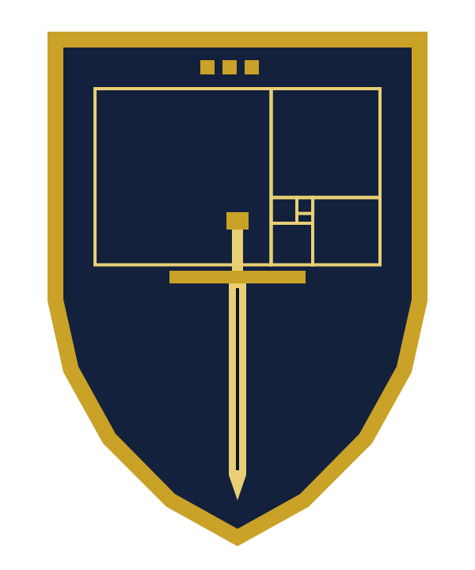

# 無何有騎士王国ヌスクァマ（Regnum Nusquamae）

> これは創作であり、遊びです。
> ヌスクァマは国家ではなく、領土・国民・通貨・旅券を持ちません。
> いかなる実在の国家・王室・騎士団・叙勲・称号とも関係がなく、それらを名乗るものでも、それらに代わるものでもありません。
> ここで授ける称号に、法的な効力はありません。
> 悪意はなく、法令を守って運営しています。
>
> 詳しくは[利用規約](policies/terms.md)と[免責事項](policies/disclaimer.md)にあります。

**国是**：Errata servo, me ipsum rego. ―― 誤りは守り、己を治める。

---

## 建国の宣言

どこにもない国がある。
その名をヌスクァマという。ラテン語で「どこにもない所」。トマス・モアが、のちに『ユートピア』となる島に最初に付けかけた名である。

どこにもない国には、誰でもない王がいる。
その名をネモという。ラテン語で「誰でもない者」。
騎士王ネモ一世は、民を持たない。治めるのは、ただ一人、自分自身である。

この王は、剣を振るわない。
王の武器は検査であり、王の盾は正誤表である。
王の偉さは、誤りの少なさでは量らない。誤りを消さずに残した、記録の正直さで量る。

王位は一代限りで、継ぐ者を置かない。
独りで立つ者だけが、独りで己を正せるからである。

ここに、無何有騎士王国ヌスクァマの建国を宣する。

―― 騎士王ネモ一世　2026年11月7日

---

## 王国基本法

**第一条（創作であること）**　この国は創作である。実在の国家・王室・騎士団・叙勲・称号と関係せず、領土・国民・通貨・旅券を持たない。

**第二条（王）**　王はただ一人、騎士王ネモ一世（Nemo I, Rex Eques Nusquamae）とする。在位は一代限りで、世襲しない。

**第三条（版図）**　王国の版図は、王の本棚と、王が公にした正誤表とする。版図は、王が誤りを一つ認めるたびに広がる。

**第四条（王の誓い）**　王は、一度立てた誓いを黙って取り下げない。誓いを改めるときは、何を何に替えたかを残す。

**第五条（王の過ち）**　王は、自らの誤りを消さず、日付を付けて記録する。消した誤りは、二度目の誤りとみなす。

**第六条（叙任）**　騎士の叙任は無償とする。金銭・物品・役務と引き換えにしない。叙任の条件は一つ、自分の誤りを一つ、公に訂正したことである。

**第七条（騎士団）**　騎士は、正誤表騎士団（Ordo Erratorum）に属する。位は「騎士」の一つだけとし、上下を設けない。

**第八条（称号を使う場所）**　この国の称号は、この国の中でだけ使う。履歴書・論文・名刺・公的な書類・学術の場には書かない。

**第九条（武）**　王国は剣を抜かない。争いは、言葉と証拠で決める。

**第十条（改正）**　この基本法は王が改める。ただし、第一条・第六条・第八条は削らない。

---

## 騎士王の十則

一　推測で空白を埋めるな。分からぬは、分からぬと書け。

二　凍った言葉を書き換えるな。正すなら、別紙に書け。

三　数を語るなら、数え直せる形で語れ。

四　肩書きで己を飾るな。騎士王の名は、この国の中でだけ許す。

五　金を取るな。払って得た位は、位ではない。

六　誤りを消すな。誤りは、王の版図である。

七　一文に一つ。剣もまた、一太刀に一つ。

八　声を張るな。厳しさは、削った量で示せ。

九　独りを恥じるな。独りで立つ者だけが、独りで己を正せる。

十　王もまた、検査に掛けよ。

---

## 国章

国章は、長方形と多角形だけで描いてある。文字の書体を使わないので、どの端末でも同じ形に描かれる。

- **盾**：紺の地に金の縁。紺は海の色で、無何有の国の島を囲む。
- **黄金比の矩形**：盾の上半分にある。正方形を一つ切り出すたびに、同じ比の矩形が残る。誤りを一つ正すたびに、同じ問いが小さく残ることを表す。
- **三つの角石**：盾の頂に並ぶ。王冠の代わりで、三つ組を表す。
- **剣**：切っ先を下に向けている。抜かない剣、すなわち第九条である。

---

## 騎士になるには

1. 自分の誤りを一つ、公に訂正する。論文の正誤表でも、ブログの追記でも、コードの修正でもよい。
2. その訂正への公開のリンクを添えて、[叙任の願い出](https://github.com/cpsbvbng26-dotcom/nusquama/issues/new?template=knighting.yml)の様式で issue を開く。
3. 王が訂正を確かめ、[正誤表騎士団の名簿](KNIGHTS.md)に名を加える。

費用はかからない。本名も、住所も、所属も書かなくてよい。GitHub のアカウント名で足りる。
叙任は創作の中のことで、法的な効力も、現実の栄誉もない。

---

## 年表

| 日付 | 出来事 |
| --- | --- |
| 2026-11-07 | 建国。基本法と十則を定め、国章を描く |
| 2026-11-07 | サイトを開き、規程を定める |
| 2026-11-08（日本時間） | MicroWiki（日本語版）に記事を書く |
| 2026-11-08（日本時間） | 適法性の説明を定める |
| 2026-11-08（日本時間） | 悪意がないことと、法令を守ることを規程に書く |
| 2026-11-08（日本時間） | 紛争は示談を優先すると定め、合意管轄の裁判所を宇都宮地方裁判所と宇都宮簡易裁判所に定める |

---

## 規程

- [利用規約](policies/terms.md)
- [免責事項](policies/disclaimer.md)
- [個人情報の取り扱い](policies/privacy.md)
- [叙任の規程](policies/knighting.md)
- [削除・訂正・辞退の求め](policies/requests.md)
- [名称と権利](policies/names.md)
- [適法性の説明](policies/legality.md)

サイト：<https://nusquama.vercel.app/>（このリポジトリの文から生成しています）

## ほかの場所

- MicroWiki（日本語版）：[ヌスクァマ](https://jp.micronations.wiki/wiki/%E3%83%8C%E3%82%B9%E3%82%AF%E3%82%A1%E3%83%9E)。2026-11-08（日本時間）に、王が自ら書いた記事です。MicroWiki は自称国家の記事を集める wiki で、記事があることは承認や登録を意味しません。

---

## ライセンスと開示

文と国章は CC BY 4.0 です。

この国の文と国章は、王の求めにより Claude Code（Anthropic）で書きました。王が確かめ、責任を負います。
Claude は騎士でも王でもありません。
