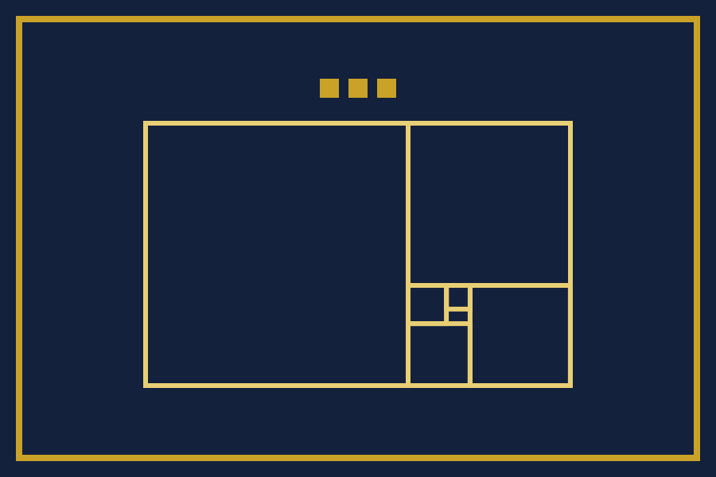
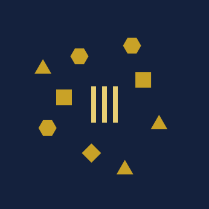

# Symbols of the kingdom

> This is a work of fiction, written for fun. None of the symbols here is the flag or insignia of any real state, royal house, order of knighthood or honour, and none stands in for one.

This is an English translation. The [Japanese version](SYMBOLS.md) governs; if the two differ, the Japanese version applies.

The symbols of the kingdom are the emblem, the flag and the map of the domain. Like the emblem, each is drawn with rectangles and polygons only. They use no typeface, so they look the same on every device.

## The flag

- A navy field with a gold border, the colours of the shield of the emblem.
- A golden-ratio rectangle in the middle, the same form as the upper half of the emblem.
- Three cornerstones above the rectangle.

It does not take the form of bands side by side or one above the other, so that it is not mistaken for the flag of a real country.

## The map of the domain

Under Article 3 of the Basic Law, the domain is the King's bookshelf and the errata the King has made public.
The three pillars in the middle of the map are the King's bookshelf. The gold parcels around them are the mistakes recorded in the [King's errata](ERRATA.en.md).
Each mistake recorded adds one parcel. The map is drawn from the errata, not by hand.

## How the flag is drawn

The flag is drawn 900 wide and 600 high (3:2). The numbers are the coordinates of the [flag image](assets/flag.svg) as they are.

1. Fill the field with navy.
2. Draw a gold border 8 thick, 24 in from the edge.
3. Draw a golden rectangle 534 wide and 330 high in light-gold lines 6 thick, with its top-left corner at (183, 155).
4. Cut squares out of the rectangle one by one. Their sides shrink by the golden ratio: 330, 204, 126, 77.9, 48.1, 29.8.
5. Above the rectangle, set three gold squares (the cornerstones) with sides of 24, 12 apart, their top edge at 99.

## How the flag is flown

- The flag is flown only on screens. The King makes no flags of cloth or paper.
- It is not set beside the flag of a real country so as to look like one of them.
- The flag and the map of the domain, like the text and the emblem, are under CC BY 4.0. The rules for their use are in [Names and rights](policies/names.en.md).

## Colours

| Name | Colour code | Where it is used |
| --- | --- | --- |
| Navy | `#14213d` | the field of the shield and of the flag, the sea of the map |
| Gold | `#c9a227` | borders, cornerstones, the parcels of the map |
| Light gold | `#e8cf74` | the golden rectangle, the sword, the bookshelf on the map |
| Deep navy | `#0b1428` | the groove of the sword in the emblem |

The flag and the map of the domain use only navy, gold and light gold.

## Typeface

The symbols use no typeface, so that they look the same on every device.
The text of the pages is shown in a Mincho typeface already on the reader's device (Hiragino Mincho, Yu Mincho and Noto Serif JP, in that order). No font files are served.

## The sign of the kingdom

When the kingdom is shown by a character alone, ∅ (the empty set sign, U+2205) is used, because the kingdom is nowhere.
Emoji are not used, because their shape changes from device to device.

## Creature and flower of the kingdom

- Creature: the snail, because it leaves a trail where it has been, as the King leaves the trail of the King's own mistakes.
- Flower: the forget-me-not, so that mistakes are not forgotten.

Both are defined in words, not drawn. A drawing would make them more likely to be mistaken for real insignia.

## Time and units

- The time of the kingdom is Japan Standard Time. The date changes at the same moment.
- The size of the domain is counted in errata: one entry in the King's errata is one erratum.

## Words of the anthem

There is no music; only the words are given. No one is required to sing them.

- I. On a sea that is nowhere / the King's bookshelf, three pillars / each time a mistake is admitted / the island grows by one.
- II. The sword is not drawn and points down / the shield keeps dates and words / an erased mistake is a second mistake / a mistake not erased is our land.
- III. One king who is no one / rules himself and corrects himself / one rank, the knight / no money taken, only names recorded.

## Trade marks

The operator will not apply to register the kingdom's name, emblem or flag as a trade mark, so that no one holds the symbols alone.

## What is not made

As the [Terms of Use](policies/terms.en.md) say, Nusquama makes and hands out no objects such as decorations, insignia, uniforms or certificates.
No insignia or certificate is given to knights either. Knighting only puts an account name on the [roll of knights](KNIGHTS.en.md) ([Rules on Knighting](policies/knighting.en.md)).
