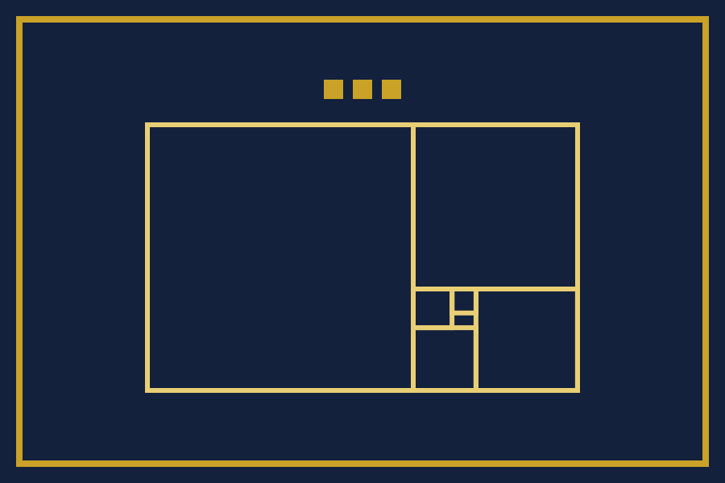
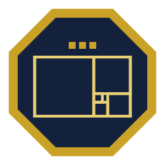

# 国のしるし

> これは創作であり、遊びです。ここに挙げるしるしは、どれも実在の国家・王室・騎士団・叙勲の旗や記章ではなく、それらに代わるものでもありません。

国のしるしは、国章と同じく、長方形と多角形だけで描いてあります。文字の書体を使わないので、どの端末でも同じ形に描かれます。

## 国旗

- 紺の地に金の縁。国章の盾と同じ色です。
- 中央に黄金比の矩形を描きます。国章の上半分と同じ形です。
- 矩形の上に、三つの角石を並べます。

帯を横や縦に並べる形は取りません。実在の国の旗と紛れないようにするためです。

## 版図の地図

基本法第三条により、版図は王の本棚と、王が公にした正誤表です。
地図の中央の三本の柱が王の本棚です。そのまわりの金の区画が、[王の正誤表](ERRATA.md)に記した誤りです。
誤りを一つ記すたびに、区画が一つ増えます。地図は正誤表から作り、手で描き足しません。

## 騎士の徽章

[騎士の名簿](KNIGHTS.md)に名がある騎士は、この徽章を、自分の頁やプロフィールに、名簿へのリンクとともに示せます。
徽章は創作の中のしるしで、法的な効力も現実の栄誉もありません。利用規約の「称号の扱い」に従い、履歴書・論文・名刺・公的な書類・学術の場には使いません。
名簿から辞退したときは、外します。

## 叙任状

騎士ごとに、名と叙任の日と正した誤りを載せた叙任状の画像を、名簿から作ります。
叙任状には「これは創作であり、法的な効力はない」と書いてあります。
名簿に騎士がいないうちは、叙任状もありません。
